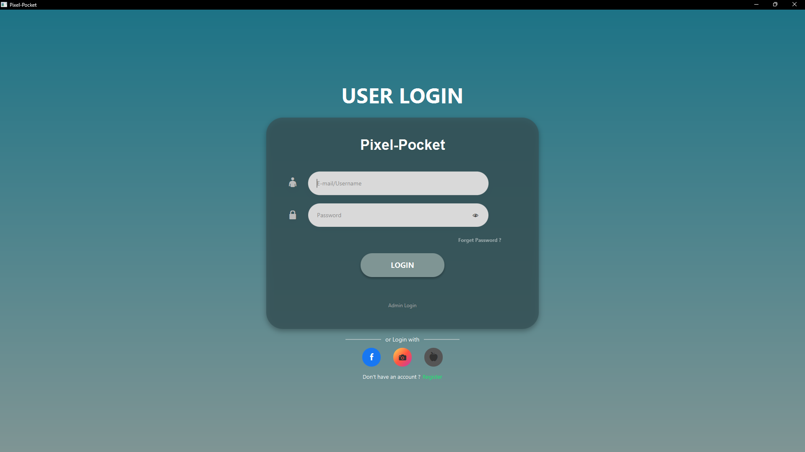
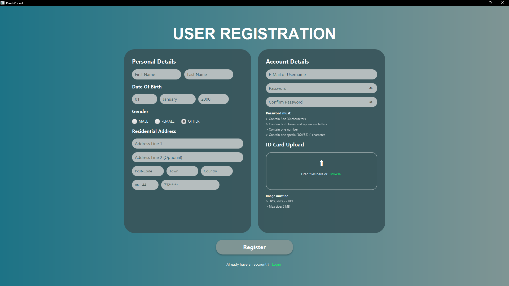
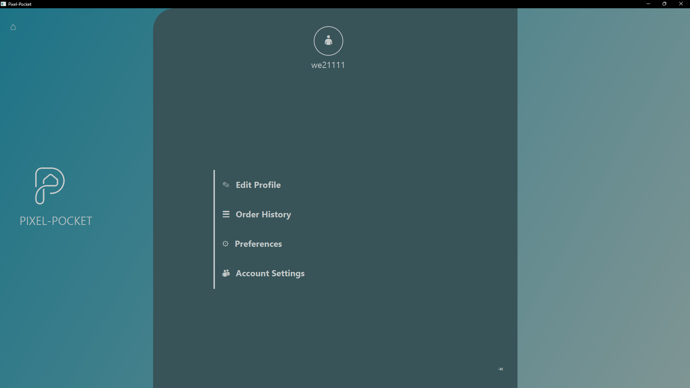

# Pixel Pocket — Customer Module

A Java-based e-commerce desktop application developed as part of a university group project.

## Project Overview
Pixel Pocket is a desktop application designed to support e-commerce operations. This repository contains the Customer module developed as part of the wider team project.

## Technologies
- Java
- JavaFX — Graphical User Interface
- SQLite — Relational Database
- JDBC — Database Connectivity
- Maven — Project Build and Dependency Management

## My Contribution
- Developed functionality for the Customer module using Java.
- Worked with JavaFX to implement the application's user interface.
- Used SQLite and JDBC for database-related integration.
- Collaborated with teammates to integrate components and troubleshoot application behaviour.

## Project Structure
- `src/main/java` — Java source code
- `src/main/resources` — Application resources
- `pom.xml` — Maven configuration

## Project Context
Developed as part of a university group project. This repository focuses on my contribution to the Customer module rather than representing the complete group application.

## Project Status
University project — archived for portfolio documentation.

## Application Screenshots

### Login Screen

### Registration Screen

### Home Dashboard

### Account Settings

### Edit Profile

### Order History

### Preferences

### Admin Login

